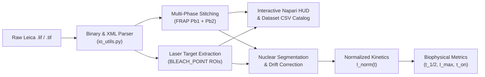

<p align="center">
  
</p>


> [!NOTE]
> **Work in Progress**: FociPy is actively developed for an MSc thesis. Data ingestion, metadata parsing, and visualization tools are operational. Segmentation and automated recruitment kinetics extraction are under active development. 

**FociPy** is a Python bioinformatics and bioimage analysis pipeline for quantifying the spatio-temporal dynamics of DNA repair protein accumulation (foci formation) following localized laser microirradiation in live cells.

Designed around **mRFP-XRCC1** (single-strand break repair scaffold) and **mCherry-53BP1** (double-strand break signaling factor) in HeLa cells, FociPy reads raw Leica confocal `.lif` and `.tif` timelapse files, extracts hardware and bleach-point metadata directly from binary XML headers, stitches multi-phase FRAP timelines, and provides interactive visualization and quantitative kinetic curves.


## Why FociPy?

In laser microirradiation experiments, a focused $488\text{ nm}$ laser pulse induces localized DNA lesions inside a cell nucleus. Fluorescently tagged repair proteins rapidly nucleate at the damage site, forming a repair focus whose intensity evolves over time.

Standard manual analysis in ImageJ/FIJI requires hand-drawing ROIs frame-by-frame, loses Leica FRAP protocol metadata, struggles with nuclear drift over 20-minute recordings, and does not scale across dose–response datasets. **FociPy** automates this workflow while preserving a complete audit trail of optical and hardware parameters.

To account for cell-to-cell expression variability (transient transfection) and imaging photobleaching, fluorescence intensity is normalized against the whole-nucleus signal at each timepoint:

$$I_{\text{norm}}(t) = \frac{I_{\text{foci}}(t) - I_{\text{bg}}(t)}{I_{\text{nuc}}(t) - I_{\text{bg}}(t)}$$

## Pipeline Architecture



## Key Features

* **Fast Native Leica `.lif` Header Parser** — Extracts UTF-16-LE XML metadata directly from binary `.lif` headers in milliseconds without loading gigabytes of pixel data into RAM.
* **Automatic Laser Target (`BLEACH_POINT`) Extraction** — Reads exact microirradiation coordinates (`ROI1..ROIn`), pulse duration ($\text{ms}$), AOTF laser power ($\%$), and pre-bleach frame counts directly from Leica FRAP Wizard metadata, converting physical scanner offsets ($\text{m}$) into image pixel coordinates $(x_{\text{px}}, y_{\text{px}})$.
* **Multi-Phase Timeline Stitching (`FRAP Series` + `FRAP Pb2/Pb3`)** — Automatically merges fast early-phase recordings (*FlyMode* `Pb1`) and slower late-phase recordings (`Pb2`) into a single continuous 4D `(T, C, Y, X)` array and unified time axis $t$.
* **Experiment-Wide Cataloging (`focipy catalog`)** — Recursively scans `data/raw/` and compiles a master CSV manifest containing resolution, field of view ($\mu\text{m}$), pixel scale, frame intervals, PMT detector gain ($\text{V}$), pinhole ($\text{Airy}$), zoom, emission bands, and irradiated cell counts.
* **Interactive Microscopy Viewer (`focipy view`)** — Opens timelapse series in **Napari** (complete with a live technical HUD overlay, physical scale bar in $\mu\text{m}$, green laser crosshairs `+`, and circular ROI overlays) or falls back to a built-in interactive **Matplotlib** frame-slider viewer.
* **Reproducible Configuration & Audit Trail** — Centralized dataclass configuration backed by YAML (`config/default_config.yaml`) and SHA-256 file hashing.

## Installation

```bash
# 1. Clone the repository
git clone https://github.com/stanuch/FociPy.git
cd FociPy

# 2. Create and activate the Conda environment (includes Napari & scientific stack)
conda env create -f environment.yml
conda activate focipy

# 3. Verify installation
focipy help
pytest -v
```

## Quick Start & CLI Usage

FociPy provides a command-line interface accessible via `focipy` (or `python -m focipy`):

### 1. Built-in Terminal Manual (`focipy help`)
```bash
focipy help
```

### 2. Inspect Series & Laser Coordinates in a `.lif` File (`focipy info`)
```bash
focipy info "data/raw/XRCC1/2026_02_26/2026_02_26 HeLa mRFP-XRCC1 12uJ.lif" --timelapse-only
```
Example output:
```text
=== 2026_02_26 HeLa mRFP-XRCC1 12uJ.lif (18 series) ===
   Idx | Name                           | Shape (T,C,Y,X)   | Dur [s] | Pixel [µm] | Pre | Laser ROIs
--------------------------------------------------------------------------------------------------------
   3+4 | 12uJ_01_02/FRAP Series02       | (25,2,512,512)    |   291.6 | 0.0601     |   3 | ROI1(296,194), ROI2(360,268)
  9+10 | 12uJ_03/FRAP Series10          | (25,2,512,512)    |   291.3 | 0.0601     |   3 | ROI1(252,246)
 19+20 | 12uJ_05/FRAP Series18          | (25,2,512,512)    |   291.4 | 0.0601     |   3 | ROI1(279,231)
```

### 3. Interactive Visualization in Napari or Matplotlib (`focipy view`)
```bash
# Open series by index or experiment name in Napari (with live HUD & µm scale bar)
focipy view "data/raw/XRCC1/2026_02_26/2026_02_26 HeLa mRFP-XRCC1 12uJ.lif" -s 3
focipy view "data/raw/XRCC1/2026_02_26/2026_02_26 HeLa mRFP-XRCC1 12uJ.lif" -s "12uJ_05"

# Force the lightweight Matplotlib slider viewer
focipy view "data/raw/53BP1/2026_05_06/20260506_mCH-53BP1 HeLa.lif" -s 2 --backend matplotlib
```

### 4. Build a Full Dataset Manifest (`focipy catalog`)
```bash
# Scan all .lif files in data/raw/ and export a comprehensive CSV catalog
focipy catalog
focipy catalog data/raw --timelapse-only -o data/processed/timelapse_catalog.csv
```

## Experimental Context

| Parameter | Specification |
| :--- | :--- |
| **Cell line** | HeLa (human cervical carcinoma, transient transfection) |
| **Fluorescent markers** | **mRFP-XRCC1** (SSB repair), **mCherry-53BP1** (DSB repair) |
| **Microscope system** | Leica TCS SP5 / SP4 Confocal (LAS AF) |
| **Objective** | HCX PL APO $63\times / 1.40\text{ OIL}$ |
| **Damage induction** | Point microirradiation ($488\text{ nm}$ laser, dose–response $8\text{–}25\ \mu\text{J}$) |
| **Acquisition modes** | Multi-phase FRAP Wizard (`Pre` + `Pb1` + `Pb2`) & standard `xyt` / *Mark & Find* |
| **Data formats** | Leica Image File (`.lif`), `.tif` / `.ome.tif` |

## Repository Structure

```text
FociPy/
├── config/
│   └── default_config.yaml      # Default pipeline & optical parameters
├── data/
│   ├── raw/                     # Original .lif microscopy files (XRCC1/, 53BP1/, calibration/)
│   └── processed/               # Generated CSV catalogs and extracted kinetics outputs
├── docs/
│   ├── CHANGELOG.md             # Version history
│   ├── METHODS.md               # Mathematical & algorithmic documentation
│   └── USAGE.md                 # Detailed user guide
├── scripts/
│   └── sorting.py               # Utility for organizing raw .lif/.maf files by protein & date
├── src/focipy/
│   ├── __init__.py              # Package version metadata
│   ├── __main__.py              # CLI entry point (focipy help / info / view / catalog)
│   ├── config.py                # Dataclass-based YAML configuration manager
│   ├── io_utils.py              # Binary .lif XML parser, phase stitching & dataset cataloger
│   └── visualization.py         # Interactive Napari (HUD + scale bar) & Matplotlib viewers
├── tests/
│   ├── test_config.py           # Configuration unit tests
│   └── test_io_utils.py         # Synthetic & real-data .lif parser tests
├── environment.yml              # Conda environment specification
└── pyproject.toml               # Python package build, dependencies, pytest & Ruff config
```

## Testing & Code Quality

Run the test suite and linter from the project root:

```bash
# Run unit and integration tests
pytest -v

# Check code formatting and linting rules
ruff check src/ tests/
```

## Documentation

* [METHODS.md](docs/METHODS.md) — Image processing pipeline and mathematical models
* [USAGE.md](docs/USAGE.md) — User guide and CLI reference
* [CHANGELOG.md](docs/CHANGELOG.md) — Version history and release notes

## License

[MIT](LICENSE) © 2026 Aleksander Stanuch
